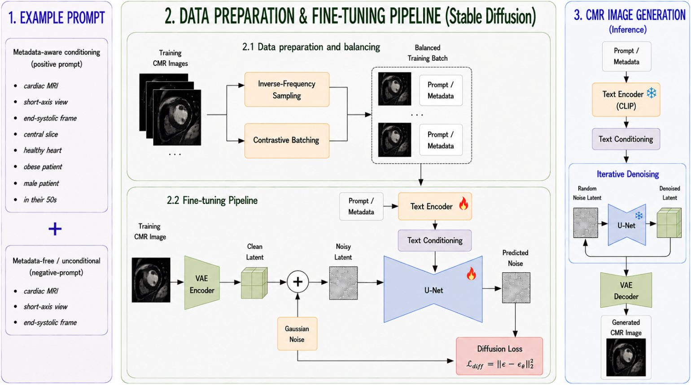
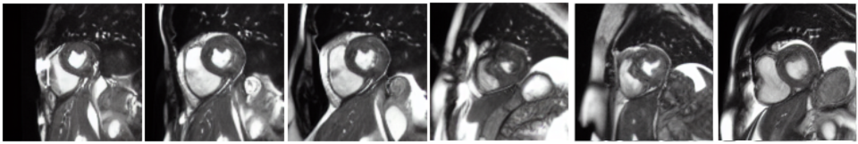

# Metadata-Aware Adaptation of a Generative Foundation Model for Conditional CMR Synthesis

<p align="center">
  <a href="https://huggingface.co/docs/diffusers"></a>
  <a href="https://pytorch.org/"></a>
  <a href="#-evaluation-metrics"></a>
  <a href="LICENSE"></a>
</p>



---

## 🚀 Overview

Reference implementation of the SIPAIM paper by Marc Rodríguez, Grzegorz Skorupko, Nay Aung, Steffen E. Petersen, Karim Lekadir and Polyxeni Gkontra.

A Stable Diffusion v1.4 model is fine-tuned to generate short-axis cardiac MRI from structured patient metadata written as text: slice position, pathology, BMI group, sex and age group.

The pipeline in this repository includes:

- **🧩 Dataset preprocessing** of end-systolic short-axis slices into images, prompts and metadata
- **🧠 Stable Diffusion fine-tuning** of the UNet and, from Setup 2 on, the text encoder
- **🏷️ Metadata-Free Classifier-Free Guidance (MF-CFG):** the unconditional branch receives the prompt without its metadata, so guidance emphasises the metadata
- **⚖️ Inverse-Frequency Sampling (IFS):** rare attribute values are drawn more often, with weights capped at τ
- **🔀 Contrastive Batching (CB):** each batch is built from distinct values of one metadata attribute
- **🖼️ Prompt-driven inference** from a single prompt
- **📊 Fidelity, distribution, diversity and subgroup metrics** (Table I and Fig. 3 of the paper)

---

## 🧪 Experimental Setups

Each setup is one YAML file in [`src/conditional_cmr/configs/`](src/conditional_cmr/configs). The files hold the hyperparameters selected for the paper, so `cmr train --setup N` reproduces each configuration directly.

| Setup | Name | Train text encoder | Metadata-free CFG | Inverse-frequency sampling | Contrastive batching |
| ----- | ---- | ------------------ | ----------------- | -------------------------- | -------------------- |
| 1 | Fine-tuned SD | ❌ | ❌ | ❌ | ❌ |
| 2 | MF-CFG | ✅ | ✅ | ❌ | ❌ |
| 3 | MF-CFG + IFS | ✅ | ✅ | ✅ | ❌ |
| 4 | MF-CFG + CB | ✅ | ✅ | ❌ | ✅ |
| 5 | MF-CFG + IFS + CB | ✅ | ✅ | ✅ | ✅ |

| Hyperparameter | Setup 1 | Setup 2 | Setup 3 | Setup 4 | Setup 5 |
| -------------- | ------- | ------- | ------- | ------- | ------- |
| UNet learning rate | 5e-6 | 5e-6 | 5e-6 | 5e-6 | 5e-6 |
| Text-encoder learning rate | – | 1e-7 | 1e-7 | 1e-7 | 1e-7 |
| Gradient accumulation | 4 | 4 | 4 | 4 | 4 |
| Metadata dropout | 0.15 | 0.15 | 0.15 | 0.15 | 0.15 |
| τ (IFS cap) | – | – | 2.0 | – | 2.0 |
| Inference steps / guidance | 40 / 3.0 | 40 / 4.0 | 40 / 4.0 | 40 / 4.0 | 40 / 3.0 |
| Best checkpoint in the paper run | 5k | 10k | – | – | 12k |

Shared by all setups: batch size 4, 12,000 optimizer steps, cosine schedule with 5 % warmup, AdamW (ε = 1e-8, 8-bit paged on CUDA), gradient clipping at 1.0, bf16 autocast with fp32 weights, 120 × 120 px, seed 42.

Setups 3 and 4 were run as ablations after Setups 1, 2 and 5. Their values were carried over from Setup 2, and τ = 2.0 is the value selected for Setup 5; the best results were obtained with τ = 2.0.

**Optional hyperparameter search (`cmr run --search`).**
- Training: each candidate of the setup's `search` space trains for 3,000 steps with batch size 2 and is scored on the first 32 testing rows.
- Inference: a grid of {15, 20, 30, 40, 50} steps × guidance {1.0, 1.5, 2.0, 3.0, 4.0, 5.0}, scored on the first 20 % of the testing split.

Both use the checkpoint-selection score described under [Evaluation Metrics](#-evaluation-metrics).

---

## 📈 Results

Paper Table I.

| Setup | MAE ↓ | MS-SSIM ↑ | FID ↓ | FRD ↓ | MAE DR →1 | MS-SSIM DR →1 |
| ----- | ----- | --------- | ----- | ----- | --------- | ------------- |
| Fine-tuned SD | 0.257 ± 0.040 | 0.192 ± 0.075 | 87.22 | 4.76 | 0.931 ± 0.189 | 0.940 ± 0.126 |
| MF-CFG | 0.254 ± 0.045 | 0.177 ± 0.079 | 44.84 | 4.64 | 1.010 ± 0.127 | 1.081 ± 0.197 |
| MF-CFG + IFS | 0.261 ± 0.041 | 0.164 ± 0.072 | 39.12 | 4.27 | 1.006 ± 0.178 | 1.032 ± 0.120 |
| MF-CFG + CB | 0.263 ± 0.042 | 0.163 ± 0.073 | 37.08 | 4.44 | 1.050 ± 0.185 | 1.056 ± 0.122 |
| MF-CFG + IFS + CB | 0.260 ± 0.043 | 0.171 ± 0.076 | 37.47 | 4.64 | 1.026 ± 0.191 | 1.063 ± 0.126 |



---

## ⚙️ Installation

Python 3.10 or newer and an NVIDIA GPU (the paper used one RTX 3090; one training run takes about 36 h).

```bash
pip install torch==2.5.1 torchvision==0.20.1 --index-url https://download.pytorch.org/whl/cu121
pip install -e ".[xformers]"
```

This installs the `cmr` command.

---

## 🏷️ Prompt Format

Each image is paired with a prompt made of a fixed acquisition context followed by its metadata (paper §III-A):

```text
Cardiac MRI, short-axis view, end-systolic frame, mid-ventricular + 1, healthy heart, obese patient, male patient, patient in their 50s.
```

| Attribute | Values |
| --------- | ------ |
| slice position | mid-ventricular - 1, mid-ventricular, mid-ventricular + 1 |
| pathology | healthy, heart failure, myocardial infarction, ischemic heart disease, atrial fibrillation |
| BMI group | underweight (< 18.5), normal BMI (18.5–24.9), overweight (25.0–29.9), obese (≥ 30.0 kg/m²) |
| sex | female, male |
| age group | 40s, 50s, 60s, 70s, 80s |

---

## 🛠️ Usage

### Training

```bash
cmr train --setup 5
```

Training fine-tunes the selected setup. Every 1,000 steps it saves a checkpoint, generates the testing split and scores it; the best checkpoint becomes `results/setup5/model/`. Add `--resume` to continue from the latest checkpoint.

### Prompt inference

```bash
cmr infer --setup 5 --prompt "Cardiac MRI, short-axis view, end-systolic frame, mid-ventricular, healthy heart, obese patient, male patient, patient in their 50s."
```

Inference loads the trained model of the setup and writes one generated image to `results/setup5/infer/`.

### Evaluation

```bash
cmr eval --setup 5
```

Evaluation generates one image per testing row (seed 42 + row index) and writes `results/setup5/eval/metrics.json` and `subgroup_fid_matrices.png`.

To recompute metrics from already generated evaluation images:

```bash
cmr eval --setup 5 --metrics-only
```

### Complete workflow

```bash
cmr run --setup 5
```

The full workflow performs:

1. **Preprocessing when required**
2. **Training hyperparameter search** (only with `--search`)
3. **Full model training**
4. **Inference hyperparameter search** (only with `--search`)
5. **Evaluation**

---

## 📏 Evaluation Metrics

Every setup is evaluated with:

- **MAE** and **MS-SSIM** between each generated image and its reference, both resized to 120 px. MS-SSIM uses four scales (weights 0.4, 0.3, 0.2, 0.1) because five do not fit at 120 px.
- **MAE and MS-SSIM diversity ratios:** mean pairwise distance within the generated set divided by the same quantity within the real set, over as many image pairs as testing images, drawn uniformly at random (seed 42). The standard deviation uses first-order error propagation, σ_DR = DR·√((σ_g/μ_g)² + (σ_r/μ_r)²).
- **FID** ([pytorch-fid](https://github.com/mseitzer/pytorch-fid), 2048-d Inception features) and **FRD** ([frd-score](https://github.com/RichardObi/frd-score), v1). Both read the image files: real images at their preprocessed resolution, generated images at 120 px. A real-vs-real FID between two random halves of the testing split is reported as a reference.
- **Subgroup FID matrices (Fig. 3):** for each attribute, the FID between every real subgroup and every generated subgroup, with the mean diagonal and off-diagonal values.

**Checkpoint selection** uses score = MAE + (1 − MS-SSIM) + worst subgroup MAE gap + worst subgroup MS-SSIM gap (subgroups with fewer than 2 images ignored). It is computed on the full testing split, with images generated using 60 denoising steps and guidance 2.0. There is no separate validation split: checkpoints and inference settings were selected on the testing split, as in the paper experiments.

---

## 🧭 Repository Structure

```text
src/conditional_cmr/
  cli.py                  `cmr` command
  config.py               RunConfig and YAML loading
  configs/setup{1..5}.yaml
  prompts.py              metadata attributes and vocabulary, grouping, metadata-free prompt, dropout
  sampling.py             Contrastive Batching and Inverse-Frequency Sampling
  data/ukbb.py            dataset preprocessing
  data/manifest.py        manifest.csv / metadata.csv
  models.py               Stable Diffusion components and pipeline
  generation.py           batched generation with MF-CFG
  training/               loop, latent and prompt caches, checkpoints and selection
  evaluation/             paired, diversity, distribution, subgroup FID
  workflows/              train, evaluate, infer, search, run
```

---

## 📁 Output Structure

### Processed data and reusable caches

```text
outputs/
  ukbb/
    images/{patient}/{patient}_v_{v}_es.png
    manifest.csv
    metadata.csv
    cache/
      vae/{resolution}/*.pt
      embedding/{resolution}/*.pt
      real_vs_real_fid.json
```

### Setup-scoped model results

```text
results/
  setupN/
    config.yaml
    model/
      unet/
      text_encoder/            (setups 2-5)
    train/
      checkpoints/step_XXXXXX/
      best_checkpoint.json
      loss_log.csv
    eval/
      generated/
      metrics.json
      subgroup_fid_matrices.png
    infer/
      generated.png
      inference.json
    search/                    (only with --search)
      training.json
      inference.json
```

---

## ⚖️ License

Code released under the [Apache License 2.0](LICENSE). No data or trained models are distributed.
